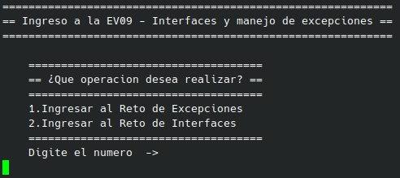
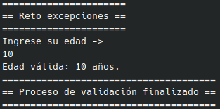
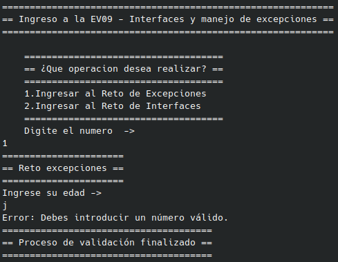
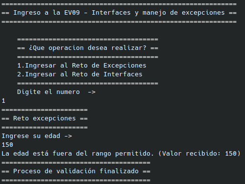
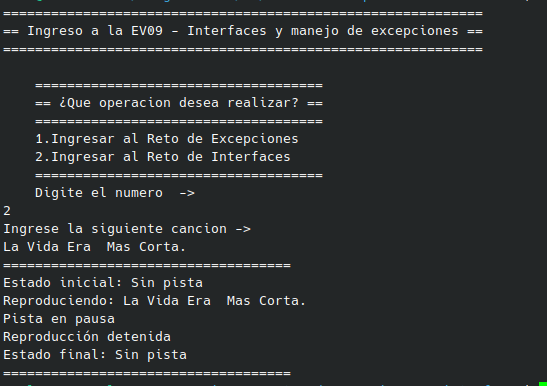

# Evidencias de como funciona

## Menu Principal

### Imagen del menu Principal, donde permite acceder a los 2 trabajos.

## Reto Exepciones.

### Imagen de como sirve el Reto de exepciones, cuando sale exitoso.

### Imagen de como sirve el Reto de exepciones, cuando sale exitoso.

### Imagen de como sirve el Reto de exepciones, cuando sale una letra.

### Imagen de como sirve el Reto de exepciones, cuando se sale del rango.

## Reto de Interfaces.

### Imagen de como sirve el Reto de Interfaces.
